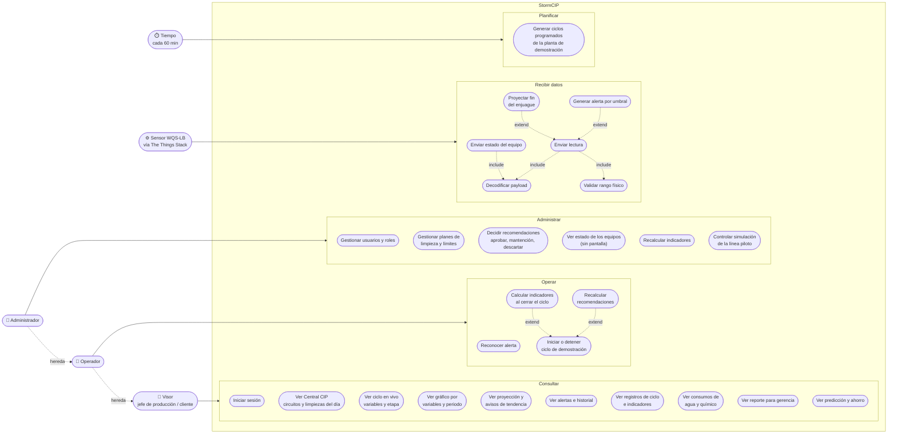
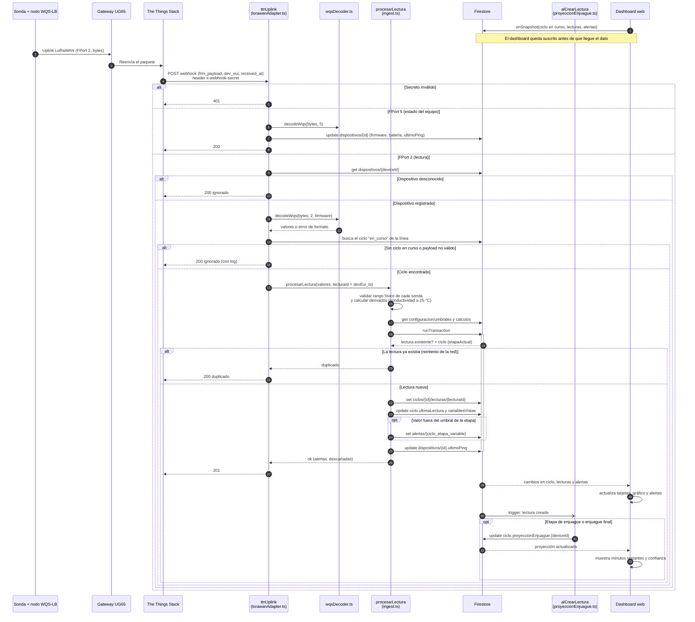
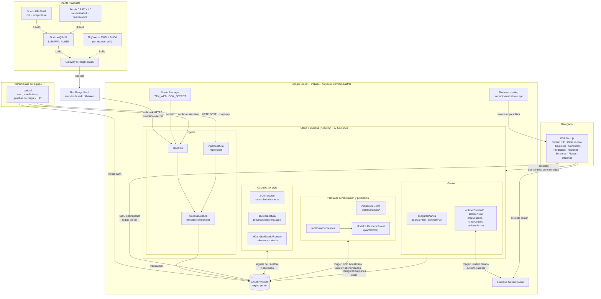
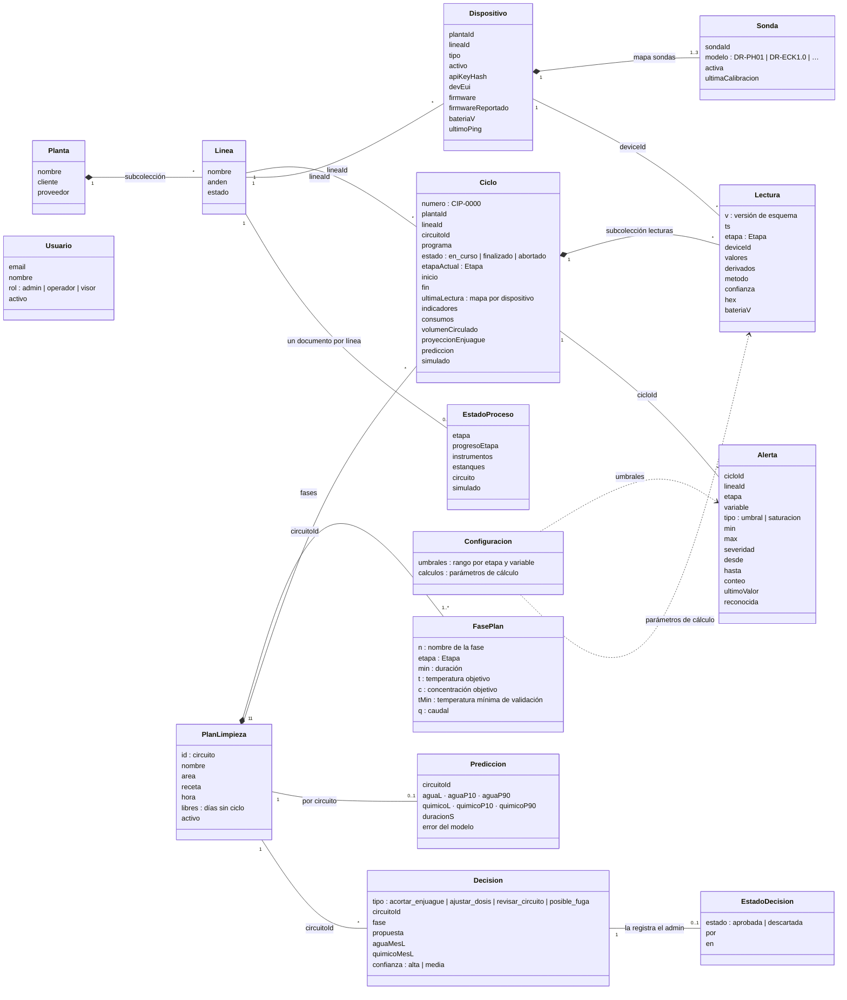

# StormCIP · Diagramas UML

Diagramas mínimos solicitados en el anexo *Artefactos y documentos solicitados por metodología*: casos de uso, secuencia de la funcionalidad principal, componentes y clases (modelo de dominio).

**Versión 2 · 23-11-2026.** Construidos a partir del código de `main` al 23-11-2026 (commit `22125d2`): `functions/src`, `firestore.rules` y `web/src`. La versión 1 (26-10-2026) se basaba en la rama `feature/HL`; los cambios están al final, en *Control de cambios*. GitHub dibuja los bloques Mermaid automáticamente; el diagrama de casos de uso está además en notación UML estándar en [`casos-de-uso.puml`](casos-de-uso.puml), y las cuatro imágenes están en [`imagenes/`](imagenes).

**Convención:** *sin pantalla* significa que el backend lo permite pero la web no tiene la opción. Los datos de la planta de demostración (8 circuitos) son simulados; la línea piloto con sensores reales es `cip-01`.

---

## 1. Casos de uso

Tres roles de usuario, cada uno hereda lo del anterior (visor → operador → administrador), y dos actores que no son personas: el sensor, que envía datos a través de The Things Stack, y el tiempo, que dispara la planificación de ciclos de la planta de demostración. Para que se lea fácil, cada actor se conecta a su grupo de casos de uso; la versión con una línea por caso, en notación UML estándar, está en [`casos-de-uso.puml`](casos-de-uso.puml).

*Extend:* se genera una alerta solo si el valor sale del umbral, la proyección se calcula solo en las etapas de enjuague, y los indicadores y las recomendaciones se recalculan solo al cerrar el ciclo.

| Caso de uso | Actor | Historia | Dónde está implementado |
|---|---|---|---|
| Iniciar sesión | Todos | HU-08 | Firebase Authentication, `web/src/app/login`; cada pantalla muestra solo lo que el rol permite |
| Ver Central CIP | Visor | — | `app/(panel)/central` |
| Ver ciclo en vivo | Visor | HU-01, HU-02 | `app/(panel)/dashboard` → `CicloEnVivoPagina.tsx`, `VistaCiclo.tsx` |
| Ver gráfico por variables y periodo | Visor | HU-04 | `GraficoPeriodo.tsx`: este ciclo, hoy, 7 días, 30 días o entre fechas |
| Ver proyección y avisos de tendencia | Visor | HU-07 | `ProyeccionCiclo.tsx`, `lib/tendencia.ts` (minutos y nivel de confianza) |
| Ver alertas e historial | Visor | HU-03 | `PanelAlertas.tsx` en `app/(panel)/sensores` |
| Ver registros de ciclo e indicadores | Visor | HU-06 | `app/(panel)/registros` (con «Imprimir registro») |
| Ver consumos de agua y químico | Visor | HU-05 | `app/(panel)/consumos` |
| Ver reporte para gerencia | Visor | — | `app/(panel)/reportes` (con «Imprimir informe») |
| Ver predicción y ahorro | Visor | HU-07 | `app/(panel)/prediccion` (lee `configuracion/oportunidades`) |
| Reconocer alerta | Operador | HU-03 | `PanelAlertas.tsx`; la regla solo permite cambiar `reconocida*` |
| Iniciar o detener ciclo de demostración | Operador | HU-11 | Función `iniciarCicloDemo` (rechaza al visor); detener escribe `detener: true` en el ciclo |
| Calcular indicadores al cerrar el ciclo | Sistema | HU-06 | Trigger `alCerrarCiclo` |
| Recalcular recomendaciones | Sistema | HU-07 | Trigger `recalcularDecisiones` con los modelos de `planta/ml.ts` |
| Gestionar usuarios y roles | Administrador | HU-09 | `app/(panel)/usuarios`; funciones `listarUsuarios`, `crearUsuario`, `setUserRole`, `setUserActivo`; restablecer contraseña por correo. No deja la planta sin administrador |
| Gestionar planes de limpieza y límites | Administrador | — | `app/(panel)/configuracion`; funciones `asegurarPlanes`, `guardarPlan`, `eliminarPlan` (validan el plan en el servidor) |
| Decidir recomendaciones | Administrador | HU-07 | `app/(panel)/prediccion`; guarda el estado en `configuracion/decisiones` |
| Ver estado de los equipos | Administrador | HU-10 | Lectura de `dispositivos` (solo admin); la web aún no tiene la tarjeta |
| Recalcular indicadores | Administrador | HU-06 | Función `recalcularIndicadores` y `scripts/recalcular.js` |
| Controlar simulación de la línea piloto | Administrador | HU-11 | `ControlSimulacion.tsx` escribe en `simulacionControl`; requiere el simulador corriendo (`npm run sim:cip`) |
| Enviar lectura / estado | Sensor | HU-12, HU-10 | Función `ttnUplink` (FPort 2 y FPort 5) |
| Proyectar fin del enjuague | Sistema | HU-07 | Trigger `alCrearLectura` (solo en enjuague y enjuague final) |
| Generar ciclos programados | Tiempo | — | Función programada `planificarCiclos` (cada 60 min, según la hora y los días de cada plan) |

---

## 2. Secuencia de la funcionalidad principal: una lectura del sensor llega al dashboard

Es el flujo central del sistema. El dashboard no consulta periódicamente: queda suscrito a Firestore y recibe los cambios apenas se escriben. Al final, la lectura nueva dispara la proyección del fin del enjuague.

Puntos de diseño que muestra el diagrama:

- **Idempotencia:** el ID de la lectura es `devEui_segundos`, así que un reintento de The Things Stack no la duplica.
- **La etapa la decide el ciclo, no el sensor:** se lee `etapaActual` dentro de la transacción.
- **Rechazos de negocio responden 200:** así The Things Stack no reintenta en bucle; solo un secreto inválido responde 401.
- **La proyección va aparte:** la calcula un trigger después de guardar la lectura, para no alargar la respuesta al webhook.

---

## 3. Componentes

Las 17 funciones están desplegadas en el proyecto `stormcip-austral` (23-11-2026). Quince corren en `southamerica-west1` (Santiago); las dos marcadas con \* corren en `southamerica-east1` (São Paulo).

| Componente | Responsabilidad | Interfaz |
|---|---|---|
| `ttnUplink` | Autentica el webhook, decodifica FPort 2 y 5, resuelve el ciclo en curso | HTTPS POST con `x-webhook-secret` |
| `ingestLectura` | Endpoint para emisores que mandan JSON ya decodificado (simuladores, ESP32) | HTTPS POST `/api/ingest` con `x-api-key` (se guarda solo su hash) |
| `procesarLectura` | Valida rangos físicos, calcula derivados, escribe lectura y alertas en una transacción | Función interna compartida por los dos endpoints |
| `alCerrarCiclo` / `recalcularIndicadores` | Calcula los indicadores del ciclo | Trigger de Firestore / *callable* (solo admin) |
| `alCrearLectura` | Proyecta en minutos el fin del enjuague, con nivel de confianza | Trigger de Firestore (lectura creada) |
| `alCambiarEstadoProceso` | Integra el caudal y acumula los litros circulados por etapa | Trigger de Firestore (`estadoProceso`) |
| `iniciarCicloDemo` | Inicia un ciclo de la planta de demostración con su plan | *Callable* (operador o admin) |
| `planificarCiclos` \* | Genera los ciclos programados de cada circuito según su plan | Función programada, cada 60 min |
| `recalcularDecisiones` + `planta/ml.ts` | Recalcula las predicciones (Random Forest) y las recomendaciones de ahorro | Trigger de Firestore (ciclo actualizado) |
| `asegurarPlanes` / `guardarPlan` / `eliminarPlan` | Planes de limpieza por defecto, alta, modificación y baja, con validación | *Callables* (gestión: solo admin) |
| `onUserCreated` \* / `setUserRole` / `listarUsuarios` / `crearUsuario` / `setUserActivo` | Rol por defecto `visor`, alta de cuentas, cambio de rol, activar o desactivar | Trigger de Auth / *callables* (solo admin) |
| Cloud Firestore | Persistencia y tiempo real; las reglas aplican los permisos por rol | SDK cliente y Admin SDK |
| Web | Visualización, gestión y control de la demo según el rol | Exportación estática en Firebase Hosting |

\* `onUserCreated` es de 1ª generación y esa generación no existe en `southamerica-west1`; `planificarCiclos` es la función programada.

---

## 4. Clases: modelo de dominio

El código no usa clases (es TypeScript con funciones y tipos), así que el diagrama de clases representa el **modelo de dominio**: los documentos de Firestore, sus atributos principales y cómo se relacionan. Los tipos están en `functions/src/types.ts` y `functions/src/planta/`.

Notas del modelo:

- **Lectura** vive dentro de su **Ciclo** (`ciclos/{id}/lecturas`); el histórico entre ciclos se consulta como grupo de colección.
- **PlanLimpieza** se guarda en `configuracion/planes` (un documento con los 8 planes de fábrica y los que cree el administrador). Un plan corresponde a un circuito; el ciclo copia sus fases al iniciarse.
- **Predicción** y **Decisión** se guardan juntas en `configuracion/oportunidades` (las recalcula `recalcularDecisiones`); **EstadoDecision**, en `configuracion/decisiones`.
- **Etapa** toma los valores `preenjuague`, `alcalino`, `enjuague`, `acido`, `enjuague_final` y `desinfeccion`; solo las tres de agua están dentro del rango de las sondas.
- **Configuracion.calculos** guarda `factorCompensacionEC`, `conductividadAguaRed`, `caudalNominalM3h` y `criterioLimpio`.
- **Confianza** de cada valor: `medido`, `estimado`, `saturado` o `fuera_de_operacion`.
- **Alerta** tiene un ID determinista `{ciclo}_{etapa}_{variable}`, para no duplicarse; un episodio reconocido que vuelve a dispararse se reescribe como nuevo.
- **Usuario** guarda el rol también como *custom claim* de Firebase Authentication, que es lo que leen las reglas; `activo: false` deshabilita la cuenta.
- `simulacionControl`, `simulacionEstado`, `configuracion/contador` y `ciclos/{id}/eventosVolumen` son documentos de apoyo (control de la demo, numeración y cálculo del volumen) y no se incluyen en el diagrama.

---

## Control de cambios

| Versión | Fecha | Cambios |
|---|---|---|
| 1 | 26-10-2026 | Primera versión, desde la rama `feature/HL`. |
| 2 | 23-11-2026 | Desde `main` (commit `22125d2`). **Casos de uso:** pasan a existentes los históricos (gráfico por variables y periodo), la proyección, la gestión del ciclo desde la web, la asignación de roles (pantalla Usuarios) y la configuración (planes de limpieza y límites); se agregan Central CIP, registros, consumos, reportes, predicción y ahorro, decidir recomendaciones y el actor Tiempo. **Secuencia:** se agrega la proyección del fin del enjuague. **Componentes:** de 6 a 17 funciones, módulo de predicción y proyecto `stormcip-austral`. **Modelo de dominio:** se agregan PlanLimpieza, FasePlan, Predicción, Decisión y EstadoDecision, y `activo` en Usuario. |
