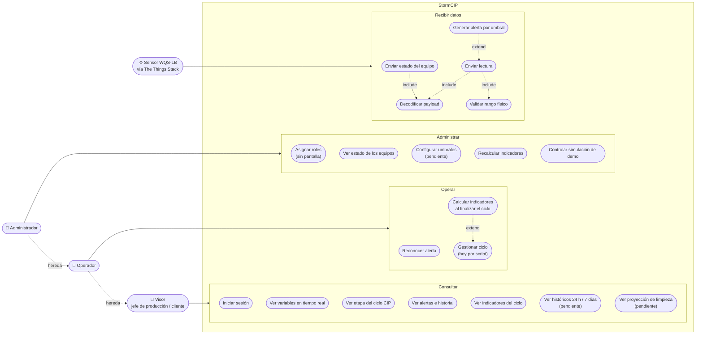
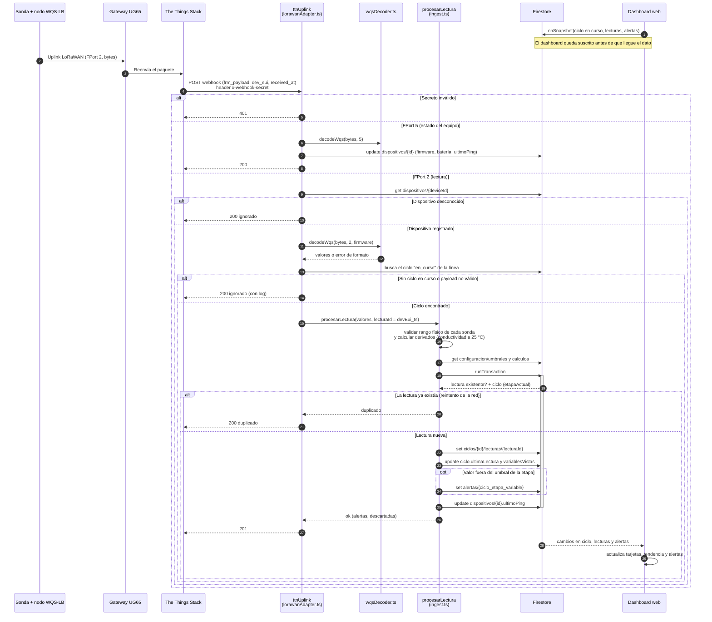
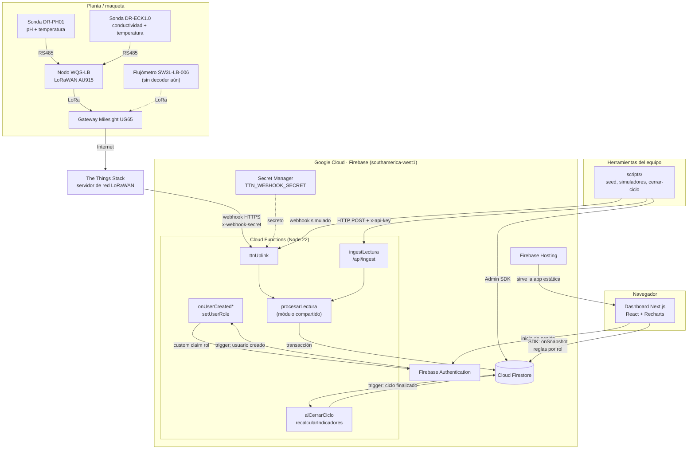
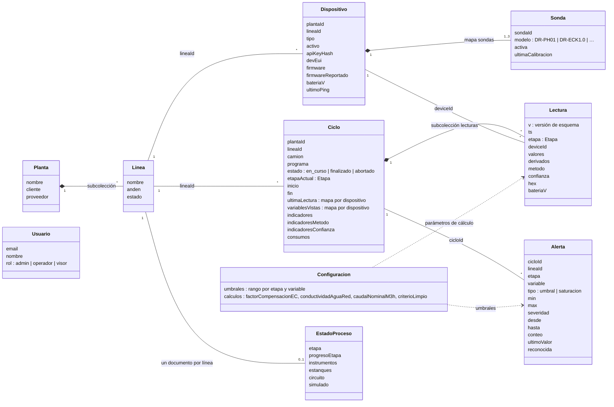

# StormCIP · Diagramas UML

Diagramas mínimos solicitados en el anexo *Artefactos y documentos solicitados por metodología*: casos de uso, secuencia de la funcionalidad principal, componentes y clases (modelo de dominio).

Están construidos a partir del código de la rama `feature/HL` (octubre 2026): `functions/src`, `firestore.rules` y `web/src`. GitHub dibuja los bloques Mermaid automáticamente; el diagrama de casos de uso está además en notación UML estándar en [`casos-de-uso.puml`](casos-de-uso.puml).

**Convención:** lo marcado como *pendiente* está en el plan pero aún no existe en el código; *sin pantalla* significa que el backend lo permite pero la web no tiene la opción.

---

## 1. Casos de uso

Tres roles de usuario, cada uno hereda lo del anterior (visor → operador → administrador), y un sistema externo: el sensor que envía datos a través de The Things Stack. Para que se lea fácil, cada actor se conecta a su grupo de casos de uso; la versión con una línea por caso, en notación UML estándar, está en [`casos-de-uso.puml`](casos-de-uso.puml).

*Extend:* se genera una alerta solo si el valor sale del umbral, y los indicadores se calculan solo al finalizar el ciclo.

| Caso de uso | Actor | Historia | Dónde está implementado |
|---|---|---|---|
| Iniciar sesión | Todos | HU-08 | Firebase Authentication, `web/src/app/login` |
| Ver variables en tiempo real | Visor | HU-01 | `useDatosCip.ts` (escucha `ciclos` y `lecturas`) |
| Ver etapa del ciclo | Visor | HU-02 | `BarraEtapas.tsx`, `useEstadoProceso.ts` |
| Ver alertas e historial | Visor | HU-03 | `PanelAlertas.tsx`, `HistorialAlertas.tsx` |
| Ver indicadores del ciclo | Visor | HU-06 | `IndicadoresCiclo.tsx` |
| Reconocer alerta | Operador | HU-03 | `PanelAlertas.tsx`; la regla solo permite cambiar `reconocida*` |
| Gestionar ciclo | Operador | — | Las reglas lo permiten al operador; hoy lo hacen `scripts/cerrar-ciclo.js` y los simuladores |
| Asignar roles | Administrador | HU-09 | Función `setUserRole`; la web no la usa |
| Ver estado de los equipos | Administrador | HU-10 | Lectura de `dispositivos` (solo admin); tarjeta completa pendiente |
| Recalcular indicadores | Administrador | HU-06 | Función `recalcularIndicadores` y `scripts/recalcular.js` |
| Controlar simulación de demo | Administrador | HU-11 | `ControlSimulacion.tsx` escribe en `simulacionControl` |
| Enviar lectura / estado | Sensor | HU-12, HU-10 | Función `ttnUplink` (FPort 2 y FPort 5) |

---

## 2. Secuencia de la funcionalidad principal: una lectura del sensor llega al dashboard

Es el flujo central del sistema. El dashboard no consulta periódicamente: queda suscrito a Firestore y recibe los cambios apenas se escriben.

Puntos de diseño que muestra el diagrama:

- **Idempotencia:** el ID de la lectura es `devEui_segundos`, así que un reintento de The Things Stack no la duplica.
- **La etapa la decide el ciclo, no el sensor:** se lee `etapaActual` dentro de la transacción.
- **Rechazos de negocio responden 200:** así The Things Stack no reintenta en bucle; solo un secreto inválido responde 401.

---

## 3. Componentes

| Componente | Responsabilidad | Interfaz |
|---|---|---|
| `ttnUplink` | Autentica el webhook, decodifica FPort 2 y 5, resuelve el ciclo en curso | HTTPS POST con `x-webhook-secret` |
| `ingestLectura` | Endpoint para emisores que mandan JSON ya decodificado (simuladores, ESP32) | HTTPS POST `/api/ingest` con `x-api-key` (se guarda solo su hash) |
| `procesarLectura` | Valida rangos físicos, calcula derivados, escribe lectura y alertas en una transacción | Función interna compartida por los dos endpoints |
| `alCerrarCiclo` / `recalcularIndicadores` | Calcula los indicadores del ciclo | Trigger de Firestore / función *callable* (solo admin) |
| `onUserCreated` / `setUserRole` | Rol por defecto `visor` y cambio de rol | Trigger de Auth / *callable* (solo admin) |
| Cloud Firestore | Persistencia y tiempo real; las reglas aplican los permisos por rol | SDK cliente y Admin SDK |
| Dashboard web | Visualización en vivo, alertas, indicadores, control de demo | Exportación estática en Firebase Hosting |

\* `onUserCreated` corre en `southamerica-east1`: es de 1ª generación y esa generación no existe en `southamerica-west1`.

---

## 4. Clases: modelo de dominio

El código no usa clases (es TypeScript con funciones y tipos), así que el diagrama de clases representa el **modelo de dominio**: los documentos de Firestore, sus atributos principales y cómo se relacionan. Los tipos están en `functions/src/types.ts`.

Notas del modelo:

- **Lectura** vive dentro de su **Ciclo** (`ciclos/{id}/lecturas`); el histórico entre ciclos se consulta como grupo de colección.
- **Etapa** toma los valores `preenjuague`, `alcalino`, `enjuague`, `acido`, `enjuague_final` y `desinfeccion`; solo las tres de agua están dentro del rango de las sondas.
- **Confianza** de cada valor: `medido`, `estimado`, `saturado` o `fuera_de_operacion`.
- **Alerta** tiene un ID determinista `{ciclo}_{etapa}_{variable}`, para no duplicarse; un episodio reconocido que vuelve a dispararse se reescribe como nuevo.
- `simulacionControl` y `simulacionEstado` (uno por línea) existen solo para la demo y no se incluyen en el diagrama.
