# Manual de usuario — Storm CIP

**Versión:** 1.0 · 23-11-2026 · corresponde a la aplicación publicada en https://stormcip-austral.web.app (commit `44205a9`).
**Para quién:** operadores, jefes de producción y administradores de una planta que limpia sus circuitos con CIP.

Storm CIP muestra cada limpieza CIP mientras ocurre, guarda su registro y avisa cuando algo se sale de lo esperado.
Hoy la aplicación trabaja con una **planta de demostración**: 8 circuitos con datos simulados. Por eso todas las pantallas llevan la etiqueta «Datos de demostración».

## Contenido

1. [Entrar a la aplicación](#1-entrar-a-la-aplicación)
2. [Qué puede hacer cada rol](#2-qué-puede-hacer-cada-rol)
3. [Cómo está organizada la pantalla](#3-cómo-está-organizada-la-pantalla)
4. [Central CIP: el estado de la planta hoy](#4-central-cip-el-estado-de-la-planta-hoy)
5. [Ciclo en vivo](#5-ciclo-en-vivo)
6. [Registros de ciclo](#6-registros-de-ciclo)
7. [Consumos](#7-consumos)
8. [Predicción y ahorro](#8-predicción-y-ahorro)
9. [Reportes](#9-reportes)
10. [Sensores WQS-LB](#10-sensores-wqs-lb)
11. [Planes de limpieza y límites](#11-planes-de-limpieza-y-límites)
12. [Usuarios](#12-usuarios)
13. [Problemas frecuentes](#13-problemas-frecuentes)
14. [Glosario](#14-glosario)

## 1. Entrar a la aplicación

1. Abre https://stormcip-austral.web.app y elige **Entrar**, o ve directo a `/login`.
2. Escribe tu correo y tu contraseña y pulsa **Entrar**.
3. La aplicación abre **Central CIP**.

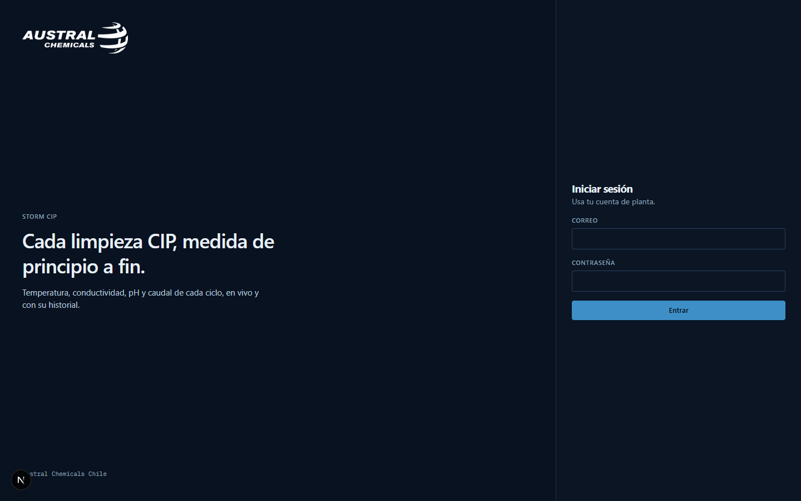

- Las cuentas las crea un administrador (sección 12). No hay registro público.
- La pantalla de inicio no tiene «olvidé mi contraseña»: pide a un administrador que use **Restablecer** en la pantalla Usuarios y recibirás un correo para definir una nueva.
- Para cerrar la sesión usa **Salir**, abajo a la izquierda.

## 2. Qué puede hacer cada rol

| Acción | Visor | Operador | Administrador |
|---|---|---|---|
| Ver todas las pantallas de monitoreo, registros, consumos y reportes | Sí | Sí | Sí |
| Iniciar y detener un ciclo de demostración | No | Sí | Sí |
| Aprobar o descartar decisiones de Predicción y ahorro | No | No | Sí |
| Crear, modificar o eliminar planes de limpieza; modificar límites | No | No | Sí |
| Crear usuarios, cambiar roles, desactivar cuentas | No | No | Sí |

Tu rol aparece bajo tu correo, abajo a la izquierda. Si entras a una página que tu rol no permite, verás el aviso **Sin permisos**.

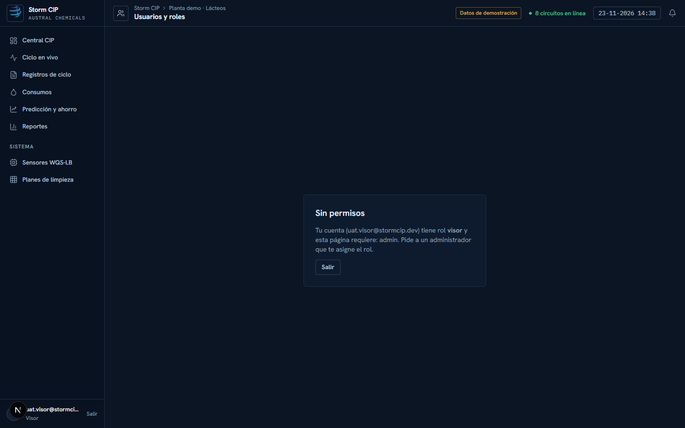

## 3. Cómo está organizada la pantalla

- **Menú lateral:** las pantallas de monitoreo arriba y, bajo «Sistema», los sensores, los planes de limpieza y (solo administradores) los usuarios.
- **Barra superior:** el nombre de la pantalla, cuántos ciclos hay en curso, la fecha y hora, y una campana con las alertas que requieren una decisión. La campana lleva a Predicción y ahorro.
- Un punto celeste junto a **Ciclo en vivo** indica que hay un ciclo corriendo.

## 4. Central CIP: el estado de la planta hoy

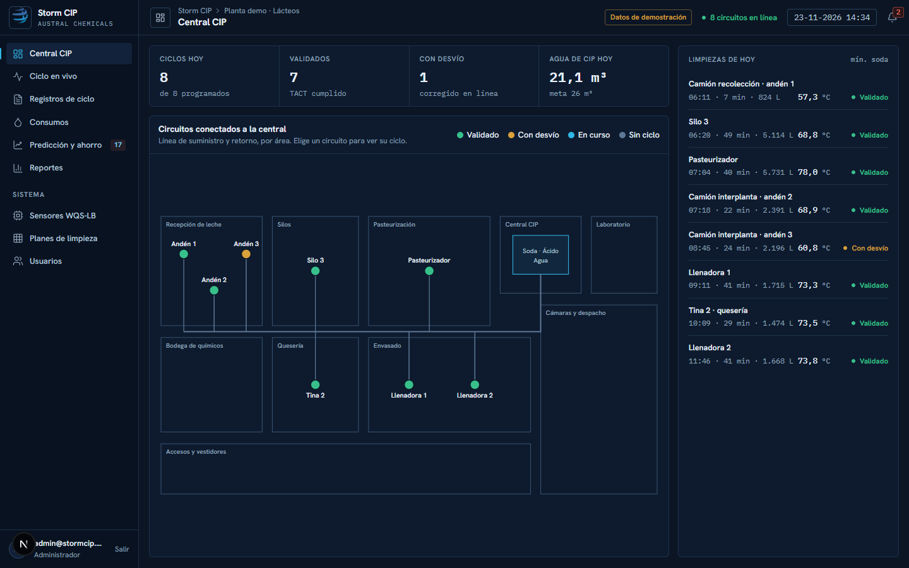

- **Arriba:** ciclos de hoy contra los programados, cuántos se validaron, cuántos tuvieron desvío y el agua usada frente a la meta diaria.
- **Plano:** cada punto es un circuito. Verde: validado. Ámbar: con desvío. Celeste: en curso. Gris: sin ciclo hoy.
- **Limpiezas de hoy:** la lista de ciclos con su hora, duración, agua y la temperatura mínima que alcanzó la soda.

Haz clic en un circuito del plano o en una fila de la lista para abrir su ciclo en vivo o su registro.
Los circuitos creados por un administrador (sección 11) todavía no aparecen en el plano; sí aparecen en la lista y en el resto de la aplicación.

## 5. Ciclo en vivo

Muestra el ciclo que está corriendo. Si no hay ninguno, muestra el último ciclo cerrado del circuito elegido.

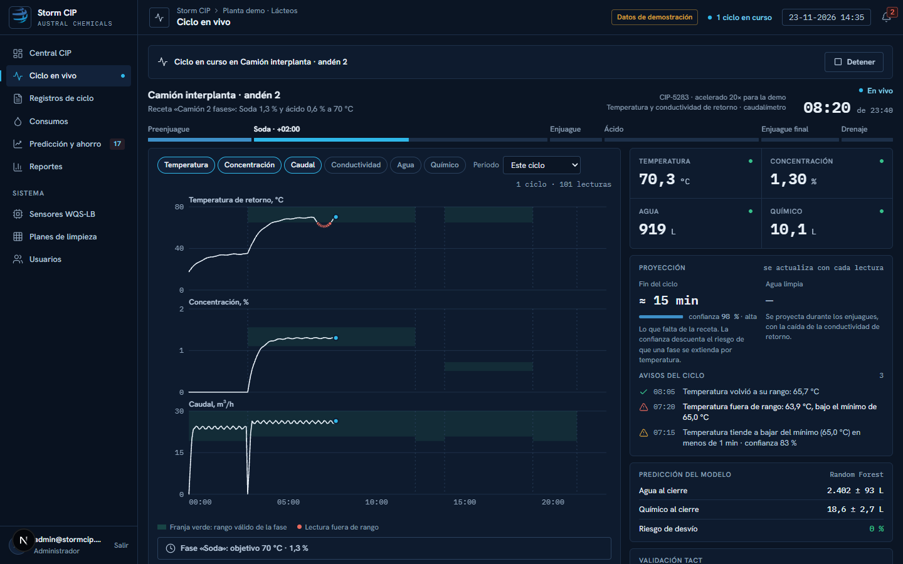

### 5.1 Iniciar un ciclo de demostración

1. Elige el **Circuito** y el **Escenario** («Ciclo normal» o «Con caída de temperatura»).
2. Pulsa **Iniciar ciclo de demostración**. Solo operadores y administradores.
3. El ciclo corre en la nube a 20 veces la velocidad real: un ciclo de 24 minutos tarda cerca de un minuto y medio.
4. Para cortarlo, pulsa **Detener**. El ciclo queda como «Abortado».

Solo puede haber un ciclo en curso por circuito.

### 5.2 Leer la pantalla

- **Barra de fases:** las fases del plan en proporción a su duración. La fase en curso avanza; si una fase se extendió, lo indica (por ejemplo «Soda · +02:00»).
- **Lecturas:** temperatura, concentración, agua y químico acumulados. El punto pasa a ámbar cuando la variable está fuera de su rango.
- **Validación TACT:** temperatura, acción mecánica, concentración y tiempo de la fase en curso.
- **Mensaje bajo el gráfico:** qué está pasando ahora. Si una variable va hacia su límite, este mensaje lo dice primero.

### 5.3 El gráfico: elegir variables y periodo

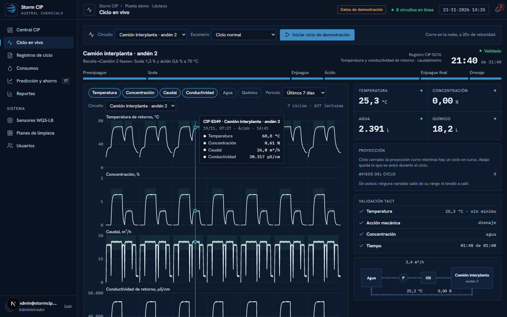

- **Variables:** pulsa los botones para mostrar u ocultar Temperatura, Concentración, Caudal, Conductividad, Agua y Químico. Cada variable tiene su propio carril con su escala. Debe quedar al menos una.
- **Periodo:** «Este ciclo», «Hoy», «Últimos 7 días», «Últimos 30 días» o «Entre fechas» (aparecen dos campos de fecha).
- **Circuito:** con un periodo mayor que el ciclo, elige entre el circuito mostrado y «Todos los circuitos».
- Con un periodo mayor, el gráfico dibuja las lecturas de **todos los ciclos del periodo, uno tras otro**. El tiempo entre un ciclo y el siguiente no se dibuja; las fechas del eje indican cuándo empezó cada ciclo.
- **Franja verde:** el rango válido de la fase. **Puntos rojos:** lecturas fuera de rango. Con más de 24 ciclos en pantalla las franjas se omiten para no recargar el gráfico.
- **Cursor:** al pasar por el gráfico aparece el ciclo, la fecha, la fase y el valor de cada variable en ese instante.
- A la derecha de los controles se lee cuántos ciclos y lecturas se están mostrando. El máximo es 400 ciclos.

La aplicación recuerda en tu navegador las variables y el periodo que elegiste.

### 5.4 Proyección y nivel de confianza

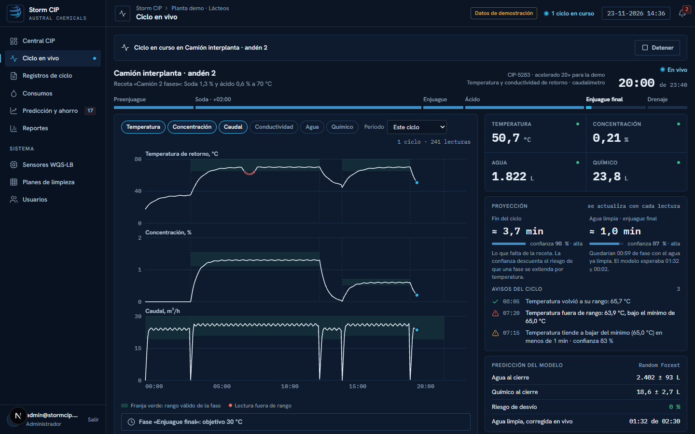

El panel **Proyección** se actualiza con cada lectura mientras hay un ciclo en curso:

| Cifra | Qué significa | De dónde sale la confianza |
|---|---|---|
| **Fin del ciclo** | Minutos que faltan para terminar | Lo que falta de la receta. La confianza descuenta el riesgo de que una fase se extienda por temperatura |
| **Agua limpia** | Minutos para que el enjuague llegue al criterio de agua limpia (200 µS/cm por defecto) | Qué tan bien las lecturas siguen una caída normal y cuántas lecturas hay. Sube a medida que avanza el enjuague |

- La confianza va de 0 a 100 %: **alta** desde 80 %, **media** desde 55 % y **baja** bajo eso.
- «Agua limpia» solo se proyecta durante los enjuagues. Necesita al menos 4 lecturas («Midiendo…»). Cuando ya se cumplió dice **Cumplido** y a qué minuto ocurrió.
- Si la proyección indica que el enjuague terminaría sin llegar a agua limpia, la cifra se muestra en ámbar y queda un aviso.

Es una estimación para apoyar la decisión. **No cambia la receta ni el PLC.**

### 5.5 Avisos del ciclo

La lista **Avisos del ciclo** guarda, con el minuto del ciclo en que ocurrió:

| Aviso | Qué hacer |
|---|---|
| ⚠ «…tiende a bajar del mínimo (65,0 °C) en menos de 1 min · confianza 83 %» | La variable aún está en rango pero va hacia su límite. Revisar el suministro (por ejemplo, vapor) antes de que salga |
| ⚠ «…fuera de rango: 63,9 °C, bajo el mínimo de 65,0 °C» | La variable salió de su rango. La fase puede extenderse |
| ✓ «…volvió a su rango» | La condición se corrigió |

Rangos que se vigilan en cada fase: temperatura sobre su mínimo, concentración entre 85 % y 120 % del objetivo y caudal sobre 80 % del nominal. Al empezar una fase hay un tiempo de ajuste en que no se avisa.

Estos avisos se ven en esta pantalla y quedan disponibles al reabrir el ciclo. No envían correo ni mensajes.

## 6. Registros de ciclo

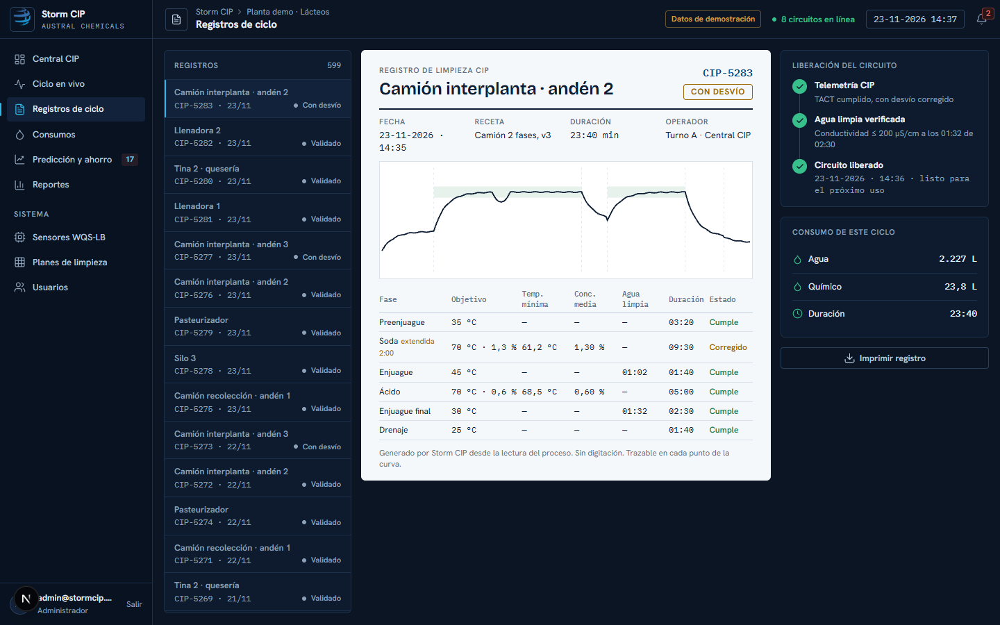

- **Lista:** todos los ciclos cerrados, con su número y estado: «Validado», «Con desvío» o «Fuera de límite».
- **Hoja del registro:** fecha, receta, duración, operador, la curva de temperatura y una fila por fase con su objetivo, la temperatura mínima alcanzada, la concentración media, a qué minuto llegó a agua limpia y su estado.
- **Liberación del circuito:** si el ciclo cumplió, si se verificó el agua limpia y si el circuito quedó liberado o retenido.
- **Imprimir registro:** abre la impresión del navegador; desde ahí se puede guardar como PDF.

## 7. Consumos

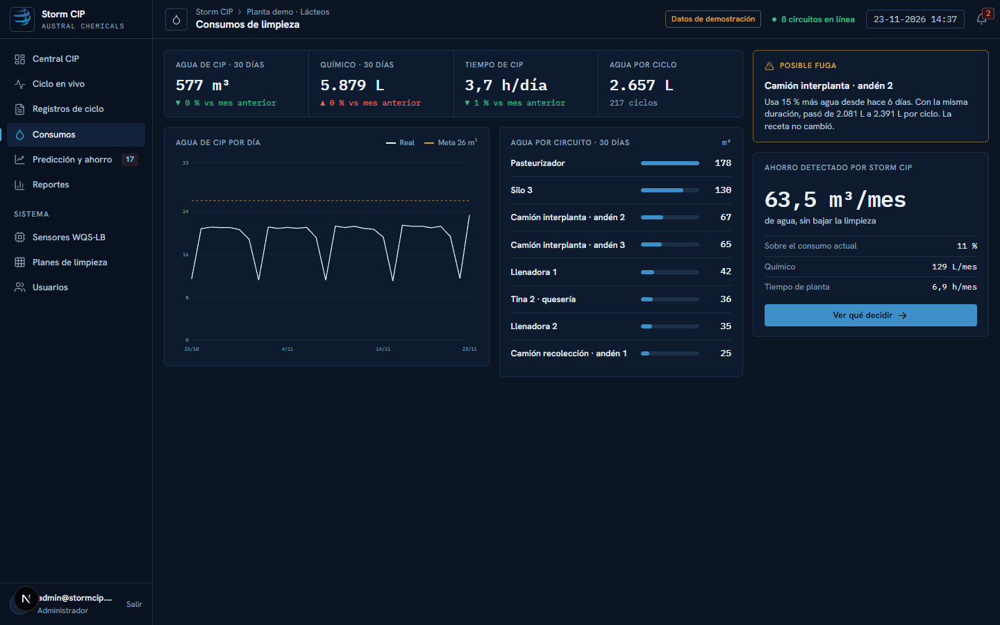

Muestra el agua y el químico de los últimos 30 días, las horas de CIP por día, el agua por ciclo, el agua de cada día frente a la meta y el agua por circuito. A la derecha aparecen las posibles fugas detectadas y el ahorro que Storm CIP estima. **Ver qué decidir** lleva a Predicción y ahorro.

La meta diaria de agua la define un administrador (sección 11).

## 8. Predicción y ahorro

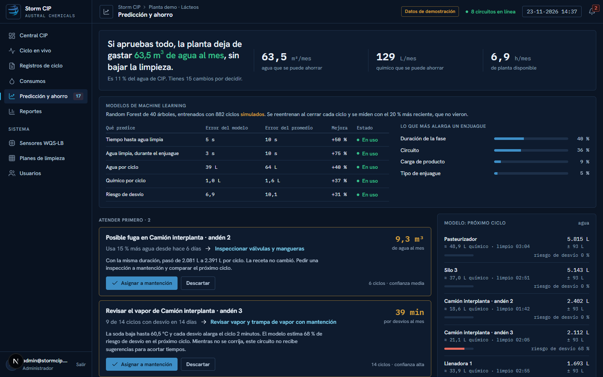

- **Arriba:** cuánta agua, químico y tiempo se ahorraría al mes si se aprueban todas las recomendaciones.
- **Modelos de machine learning:** qué predice cada modelo, su error frente al promedio y si está en uso. Los modelos se entrenan con ciclos **simulados** y se reentrenan al cerrar cada ciclo.
- **Atender primero:** posibles fugas y circuitos con desvíos repetidos.
- **Para ahorrar:** recomendaciones ordenadas por impacto, con el cambio propuesto y su explicación.

Un administrador puede **Aprobar**, **Descartar** o **Deshacer** cada recomendación. Aprobar deja constancia de quién decidió; **no cambia la receta ni el PLC**. El cambio en el plan se hace aparte, en Planes de limpieza.

## 9. Reportes

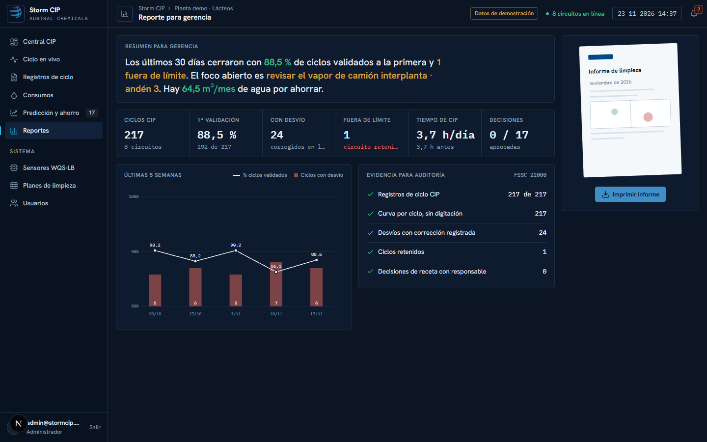

Resume los últimos 30 días: porcentaje de ciclos validados a la primera, ciclos con desvío y fuera de límite, horas de CIP por día y decisiones aprobadas. Incluye la evolución de las últimas 5 semanas y la evidencia disponible para auditoría. **Imprimir informe** abre la impresión del navegador.

## 10. Sensores WQS-LB

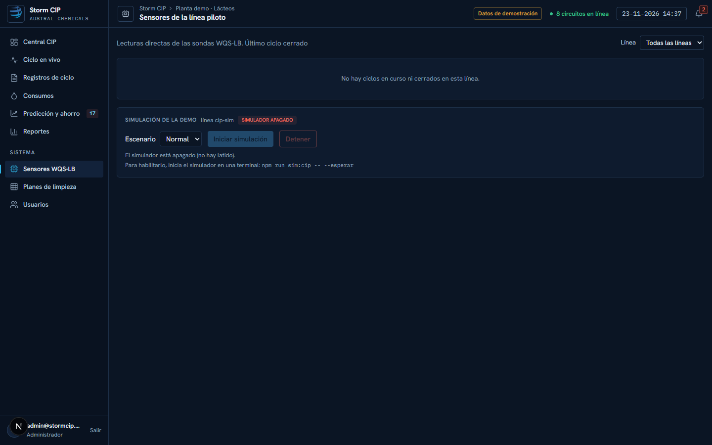

Muestra las lecturas directas de las sondas Dragino WQS-LB de la línea piloto (pH y conductividad) y permite controlar el simulador de esa línea.

- Mientras los sensores no estén instalados en la maqueta, esta pantalla indica que no hay ciclos en la línea.
- «Simulador apagado» significa que nadie ejecutó el simulador de la línea en un computador; es una herramienta del equipo técnico.

## 11. Planes de limpieza y límites

Un **plan de limpieza** es un circuito con su receta: qué fases tiene, cuánto dura cada una y con qué temperatura, concentración y caudal. Todos pueden verlos; solo un administrador los cambia.

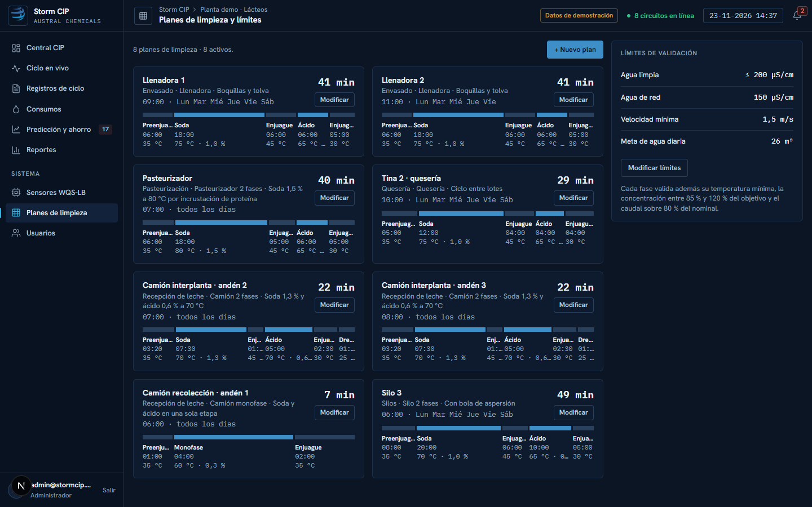

### 11.1 Crear un plan

1. Pulsa **+ Nuevo plan**.
2. Completa nombre del circuito, área y receta. El nombre corto y la descripción son opcionales.
3. Indica la **hora programada** (0 a 23) y los **días con limpieza**.
4. Revisa la tabla de fases. Para cada una: duración en minutos, temperatura objetivo, concentración (solo en Soda, Monofase y Ácido), temperatura mínima (opcional) y caudal.
5. Usa **↑ ↓** para ordenar, **Quitar** para sacar una fase y **+ fase** para agregar. Cada tipo de fase va una sola vez.
6. Pulsa **Crear plan**.

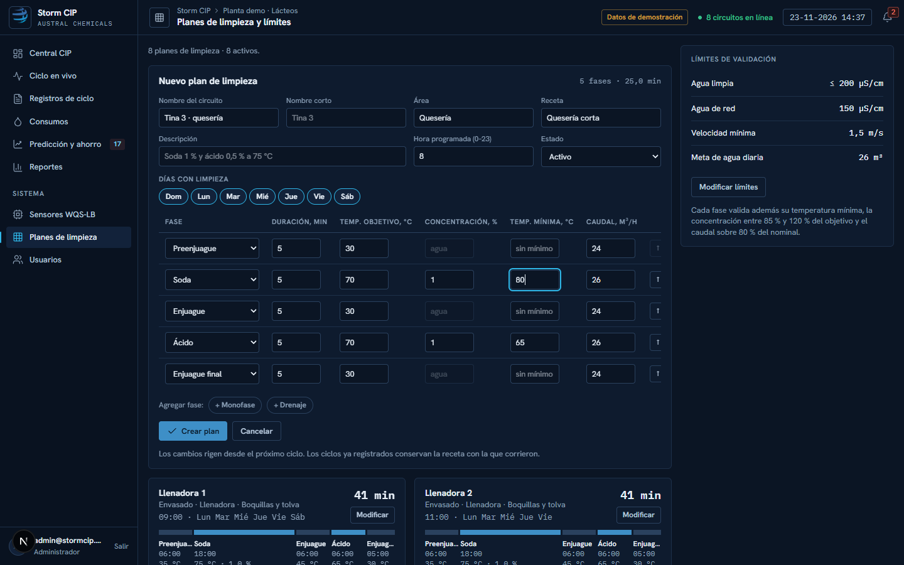

Si algo no es válido, el sistema lo explica y no guarda. Por ejemplo: «Fase 2 (Soda): la temperatura mínima no puede superar el objetivo».

| Campo | Valores aceptados |
|---|---|
| Duración de una fase | 0,5 a 180 minutos |
| Temperatura | 5 a 95 °C |
| Concentración (fases químicas) | 0,1 a 5 % |
| Caudal | 1 a 80 m³/h |
| Fases por plan | 1 a 7, sin repetir el tipo |

Se puede escribir con coma decimal (7,5).

### 11.2 Modificar, desactivar o eliminar

- **Modificar:** en la tarjeta del plan. Cambia lo que necesites y pulsa **Guardar cambios**.
- **Desactivar:** en el formulario, cambia **Estado** a «Desactivado». El plan deja de programarse y no se puede iniciar un ciclo con él, pero se conserva.
- **Eliminar plan:** pide confirmación y no se puede deshacer. No se puede eliminar un plan con un ciclo en curso.

Los cambios rigen desde el próximo ciclo. **Los ciclos ya registrados conservan la receta con la que corrieron.**

### 11.3 Límites de validación

En el panel derecho, **Modificar límites** permite cambiar:

- **Agua limpia:** conductividad máxima para considerar limpio el enjuague. Debe ser mayor que la del agua de red.
- **Agua de red:** conductividad del agua de entrada.
- **Meta de agua diaria**, en m³.

## 12. Usuarios

Solo administradores. Está en el menú, bajo «Sistema».

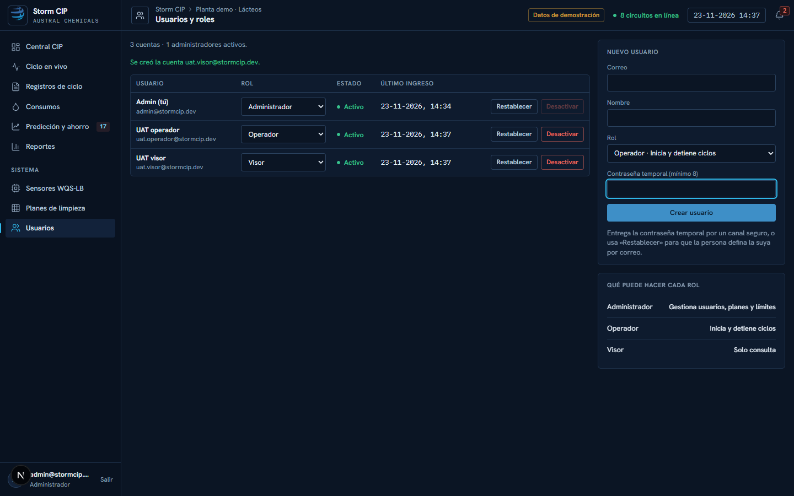

| Tarea | Cómo |
|---|---|
| Crear un usuario | En **Nuevo usuario**: correo, nombre, rol y una contraseña temporal de al menos 8 caracteres. Pulsa **Crear usuario** |
| Cambiar un rol | Elige el rol nuevo en la lista de la fila. Rige cuando la persona vuelve a iniciar sesión, o en menos de una hora |
| Restablecer la contraseña | **Restablecer** envía un correo para definir una nueva. El correo de la cuenta debe ser real |
| Desactivar una cuenta | **Desactivar** impide entrar y cierra las sesiones abiertas. **Activar** la habilita de nuevo |

Protecciones:

- No puedes desactivar tu propia cuenta.
- No se puede quitar el rol ni desactivar al único administrador activo: primero asigna otro.

Recomendación: mantén al menos dos administradores, y entrega las contraseñas temporales por un canal seguro.

## 13. Problemas frecuentes

| Problema | Qué hacer |
|---|---|
| No puedo entrar | Revisa el correo y la contraseña. Si la cuenta está desactivada, pide a un administrador que la active |
| Veo «Sin permisos» | Tu rol no permite esa página. Pide a un administrador que revise tu rol |
| Me cambiaron el rol y sigo viendo lo mismo | Sal y vuelve a entrar |
| El botón «Iniciar ciclo» está deshabilitado | Eres visor, o el plan del circuito elegido está desactivado |
| «…ya tiene un ciclo en curso» | Espera a que termine o detén el ciclo de ese circuito |
| El gráfico dice «No hay ciclos en este periodo» | Elige otro periodo o «Todos los circuitos» |
| No veo los cambios después de una actualización | Recarga con Ctrl+Shift+R. El navegador puede guardar la versión anterior hasta una hora |
| Sensores WQS-LB aparece vacío | Aún no hay sensores reales enviando datos a esa línea |

## 14. Glosario

| Término | Significado |
|---|---|
| CIP | *Clean-in-Place*: limpieza de un equipo sin desarmarlo, haciendo circular agua y químicos |
| Circuito | Equipo o línea que se limpia: un andén, un silo, el pasteurizador |
| Plan de limpieza / receta | Las fases de un ciclo y sus parámetros |
| Fase | Etapa del ciclo: preenjuague, soda, enjuague, ácido, enjuague final, drenaje |
| TACT | Temperatura, Acción mecánica, Concentración y Tiempo: las cuatro condiciones de una limpieza |
| Agua limpia | Enjuague cuya conductividad de retorno ya bajó al criterio configurado |
| Desvío | Una fase salió de su rango y se corrigió, por ejemplo extendiéndola |
| Fuera de límite | La fase no cumplió; el circuito queda retenido |
| Confianza | Qué tan firme es una proyección con las lecturas disponibles, de 0 a 100 % |
