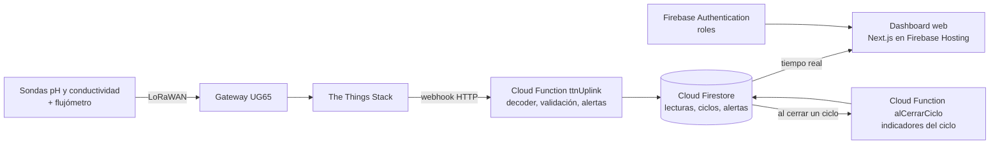

# StormCIP

**Monitoreo IoT en tiempo real de la limpieza industrial CIP (Clean-in-Place).**

Proyecto APT / Capstone · Ingeniería Informática · Duoc UC · Grupo AV_AM_800_Grupo01.

---

## Descripción

**Qué hace.** StormCIP captura las variables de un ciclo de limpieza CIP (pH, conductividad, temperatura y caudal) con sensores LoRaWAN, las guarda en la nube y las muestra en un dashboard web con historial, alertas por umbral e indicadores de cada ciclo.

**A quién va dirigido.** A plantas de alimentos que limpian sus líneas con CIP, como las plantas lácteas (por ejemplo, Soprole o Colun), y en particular a sus operadores y jefes de producción.

**Qué problema resuelve.** Hoy los sensores de la planta se ven solo en el PLC y no dejan historial. No hay datos centralizados, las decisiones son reactivas y no se sabe cuánta agua y químico consume cada ciclo. StormCIP transforma esas mediciones en información para controlar y optimizar el proceso.

**Estado actual (25 de noviembre de 2026).** El backend y la web están desplegados en Firebase (https://stormcip-austral.web.app) y funcionan con una planta de demostración de 8 circuitos con datos simulados. Ya incluye el gráfico por variables y periodo, la proyección en minutos con nivel de confianza, los avisos de tendencia, la administración de usuarios y los planes de limpieza editables. Los modelos predictivos (Random Forest) se entrenan con ciclos simulados. La maqueta tiene conectados los sensores reales de pH, conductividad, temperatura y flujo (montados el 16-11) y sus datos llegan al dashboard desde el 23-11; sigue pendiente validar los modelos con esos datos reales.

---

## Tecnologías utilizadas

| Capa | Tecnología |
|---|---|
| Sensores | Dragino WQS-LB (nodo LoRaWAN) con sondas DR-PH01 (pH) y DR-ECK1.0 (conductividad); flujómetro Dragino SW3L-LB-006 |
| Red | LoRaWAN AU915, gateway Milesight UG65, The Things Stack (webhook) |
| Backend | Firebase Cloud Functions (Node.js 22, TypeScript), `firebase-functions` 6 y `firebase-admin` 12 |
| Base de datos | Cloud Firestore (base de datos documental) |
| Autenticación | Firebase Authentication con roles por *custom claims* (`admin`, `operador`, `visor`) |
| Frontend | Next.js 16, React 19, TypeScript, Tailwind CSS 4, Recharts |
| Cloud | Google Cloud Platform: Firebase Hosting, Secret Manager; región `southamerica-west1` (Santiago) |
| Pruebas | Vitest, `@firebase/rules-unit-testing`, emuladores de Firebase |

---

## Arquitectura de la solución



| Componente | Responsabilidad |
|---|---|
| `ttnUplink` | Recibe el webhook de The Things Stack, decodifica el payload del WQS-LB, valida rangos físicos y genera alertas |
| `ingestLectura` | Endpoint HTTP (`/api/ingest`) para gateways o simuladores que envían lecturas ya decodificadas |
| `alCerrarCiclo` y `recalcularIndicadores` | Calculan los indicadores del ciclo: tiempo hasta agua limpia, arrastre químico, pendiente de conductividad y volumen estimado |
| `onUserCreated` y `setUserRole` | Asignan el rol por defecto (`visor`) y permiten a un admin cambiar roles |
| `iniciarCicloDemo`, `planificarCiclos` y `recalcularDecisiones` | Planta de demostración: ciclo en vivo a 20×, ciclos programados y reentrenamiento de los modelos al cerrar cada ciclo |
| `asegurarPlanes`, `guardarPlan` y `eliminarPlan` | Planes de limpieza CIP editables por el administrador, con validación en el servidor |
| `listarUsuarios`, `crearUsuario` y `setUserActivo` | Administración de usuarios: alta con rol, lista y activación |
| Aplicación web | Central CIP, ciclo en vivo con gráfico por variables y periodo, proyección con confianza y avisos, registros, consumos, predicción, reportes, planes de limpieza y usuarios |

Más detalle en [`EXPLICACION-SISTEMA-SENSORES.md`](AV_AM_800_Grupo01/Fase%202/Evidencias%20Proyecto/Evidencias%20de%20sistema/EXPLICACION-SISTEMA-SENSORES.md) y en el [modelo de datos](AV_AM_800_Grupo01/Fase%202/Evidencias%20Proyecto/Evidencias%20de%20sistema/Base%20de%20datos/modelo-datos-sensores.md).

---

## Ejecutar el proyecto localmente

El sistema se prueba con los **emuladores de Firebase**: una copia local de Firebase que no toca datos reales ni genera costos.

**Docker no aplica.** StormCIP no tiene servidores ni contenedores propios: el backend son Cloud Functions, la base de datos es Firestore y la web es un sitio estático en Firebase Hosting. El papel de `docker-compose` (levantar todo con un comando) lo cumple `firebase emulators:start`. La justificación está en el [documento de diseño](AV_AM_800_Grupo01/Fase%202/Evidencias%20Proyecto/Evidencias%20de%20documentaci%C3%B3n/Documentaci%C3%B3n%20t%C3%A9cnica/StormCIP_Documento_de_Diseno_v1.0.pdf), sección 6.3.

### Requisitos

- Node.js 22 (ver `.nvmrc`)
- Firebase CLI: `npm install -g firebase-tools`
- Java 21 o superior (lo exigen los emuladores de Firestore y Auth)

### Pasos

Todos los comandos se ejecutan dentro de la carpeta de la aplicación. La ruta tiene espacios y tildes, así que va entre comillas:

```bash
cd "AV_AM_800_Grupo01/Fase 2/Evidencias Proyecto/Evidencias de sistema/Aplicación/stormcip"
```

**1. Instalar dependencias**

```bash
cd functions && npm install && cd ../scripts && npm install && cd ../web && npm install && cd ..
```

**2. Configurar los secretos locales** (no se suben a git)

- `functions/.secret.local` con la línea `TTN_WEBHOOK_SECRET=test-secret`
- `web/.env.local` con:

```
NEXT_PUBLIC_USE_EMULATORS=true
NEXT_PUBLIC_FB_PROJECT_ID=stormcip-dev
NEXT_PUBLIC_FB_API_KEY=emulador-local
NEXT_PUBLIC_FB_AUTH_DOMAIN=stormcip-dev.firebaseapp.com
NEXT_PUBLIC_FB_APP_ID=emulador-local
```

**3. Levantar los emuladores** (terminal 1)

```bash
firebase emulators:start --project stormcip-dev
```

La interfaz de los emuladores queda en http://127.0.0.1:4000. Los puertos de cada emulador están en `firebase.json`.

**4. Cargar datos de prueba y simular un ciclo** (terminal 2)

```bash
cd scripts
npm run seed
npm run sim:cip
```

`npm run sim:ttn` ejecuta además 5 casos de prueba contra el webhook (uplink válido, pH fuera de rango, dispositivo desconocido, FPort 5 e idempotencia).

**5. Levantar la web** (terminal 3)

```bash
cd web
npm run dev
```

Abrir http://localhost:3000/login. El usuario administrador de prueba lo crea `scripts/seed.js`.

### Pruebas automatizadas

```bash
cd functions && npm test          # pruebas unitarias del backend
cd web && npm test                # pruebas unitarias de la web
cd functions && npm run test:reglas   # reglas de Firestore (requiere el emulador encendido)
```

Además hay pruebas de integración y de punta a punta (`npm run sim:ttn`, `e2e-volumen.js`, `e2e-quimica.js`), una prueba de carga (`carga-ingesta.js`) y un recorrido de aceptación automatizado (`uat-recorrido.js`), todos en `scripts/` y solo contra emuladores. El resultado del 23-11-2026 (522 pruebas unitarias, 20 de reglas y 38 casos de aceptación) y su evidencia están en el [plan de pruebas](AV_AM_800_Grupo01/Fase%202/Evidencias%20Proyecto/Evidencias%20de%20documentaci%C3%B3n/Plan%20de%20pruebas/StormCIP_Plan_de_Pruebas_v1.0.pdf).

Más detalle en [`README.md` de la aplicación](AV_AM_800_Grupo01/Fase%202/Evidencias%20Proyecto/Evidencias%20de%20sistema/Aplicaci%C3%B3n/stormcip/README.md). El despliegue a producción se describe en [`DESPLIEGUE.md`](AV_AM_800_Grupo01/Fase%202/Evidencias%20Proyecto/Evidencias%20de%20sistema/Aplicaci%C3%B3n/stormcip/DESPLIEGUE.md); ningún script toca producción sin flags explícitos.

---

## Documentación

Los documentos formales están en Word (`.docx`, editable) y en PDF, con el mismo nombre. Los enlaces abren el PDF.

| Documento | Para qué sirve |
|---|---|
| [Manual de usuario](AV_AM_800_Grupo01/Fase%202/Evidencias%20Proyecto/Evidencias%20de%20documentaci%C3%B3n/Manual%20de%20usuario/StormCIP_Manual_de_Usuario_v1.0.pdf) | Cómo usar cada pantalla, por rol |
| [Plan de pruebas](AV_AM_800_Grupo01/Fase%202/Evidencias%20Proyecto/Evidencias%20de%20documentaci%C3%B3n/Plan%20de%20pruebas/StormCIP_Plan_de_Pruebas_v1.0.pdf) | Qué se prueba, resultado y evidencia por sprint |
| [Acta UAT](AV_AM_800_Grupo01/Fase%202/Evidencias%20Proyecto/Evidencias%20de%20documentaci%C3%B3n/Plan%20de%20pruebas/StormCIP_Acta_UAT_v1.0.pdf) | Casos de aceptación ejecutados; pendiente de firma |
| [Lo comprado y lo construido](AV_AM_800_Grupo01/Fase%202/Evidencias%20Proyecto/Evidencias%20de%20documentaci%C3%B3n/Documentaci%C3%B3n%20t%C3%A9cnica/StormCIP_Inventario_Comprado_y_Construido_v1.1.pdf) | Inventario de equipos, software y documentos |
| [Guía de despliegue](AV_AM_800_Grupo01/Fase%202/Evidencias%20Proyecto/Evidencias%20de%20sistema/Aplicaci%C3%B3n/stormcip/DESPLIEGUE.md) | Cómo publicar funciones, reglas y Hosting |
| [Product Vision](AV_AM_800_Grupo01/Fase%202/Evidencias%20Proyecto/Evidencias%20de%20documentaci%C3%B3n/Plan%20del%20proyecto/StormCIP_Product_Vision_v1.0.pdf) | Problema, usuarios y propuesta de valor |
| [Sprint Backlog y retrospectivas](AV_AM_800_Grupo01/Fase%202/Evidencias%20Proyecto/Evidencias%20de%20documentaci%C3%B3n/Plan%20del%20proyecto/StormCIP_Sprint_Backlog_y_Retrospectivas_v1.0.pdf) | Backlog priorizado, qué se desarrolló en cada sprint y qué mejoró el equipo |
| [Definition of Done](AV_AM_800_Grupo01/Fase%202/Evidencias%20Proyecto/Evidencias%20de%20documentaci%C3%B3n/Plan%20del%20proyecto/StormCIP_Definition_of_Done_v1.0.pdf) | Criterios de término y de aceptación por historia |
| [Documento de diseño](AV_AM_800_Grupo01/Fase%202/Evidencias%20Proyecto/Evidencias%20de%20documentaci%C3%B3n/Documentaci%C3%B3n%20t%C3%A9cnica/StormCIP_Documento_de_Diseno_v1.0.pdf) | Arquitectura, modelo de datos, diagramas UML y requisitos no funcionales |
| [Manual técnico y de despliegue](AV_AM_800_Grupo01/Fase%202/Evidencias%20Proyecto/Evidencias%20de%20documentaci%C3%B3n/Documentaci%C3%B3n%20t%C3%A9cnica/StormCIP_Manual_Tecnico_y_Despliegue_v1.0.pdf) | Instalación, variables de entorno, ejecución y despliegue |
| [Informe de cierre](AV_AM_800_Grupo01/Fase%203/Evidencias%20Grupales/StormCIP_Informe_de_Cierre_v1.0.pdf) | Resultados, innovación y ubicación de cada entregable del anexo |

---

## Integrantes del equipo

| Integrante | Rol |
|---|---|
| Cristian Quilaleo | Backend, base de datos, API y almacenamiento |
| Humberto León | Frontend, UI/UX, dashboard y visualización |
| Tamara Quilaleo | Integración, tiempo real y alertas |
| Felipe Carreño | QA, pruebas, documentación y Scrum Master |
| Técnico de hardware | Armado de la maqueta y montaje de sensores |

---

## Metodología de trabajo

Trabajamos con **Scrum**: 7 sprints de 2 semanas más una semana de cierre, entre el 24-08-2026 y la demo al cliente del **04-12-2026**.

| Sprint | Fechas | Foco |
|---|---|---|
| 1 | 24 ago – 6 sep | Arquitectura y cotización de sensores |
| 2 | 7 – 20 sep | Autenticación y compra de sensores |
| 3 | 21 sep – 4 oct | Ingesta de datos y armado de la maqueta |
| 4 | 5 – 18 oct | Primer flujo de punta a punta |
| 5 | 19 oct – 1 nov | Visualización completa e históricos |
| 6 | 2 – 15 nov | Roles, seguridad y robustez |
| 7 | 16 – 29 nov | Pruebas integrales y UAT |
| Cierre | 30 nov – 4 dic | Ajustes finales y presentación del MVP |

El backlog, los hitos y los riesgos se gestionan en la planilla del plan del proyecto. Los artefactos de Scrum están en la carpeta del plan del proyecto: *Product Vision*, *Sprint Backlog* con retrospectivas y *Definition of Done*. Los sprints 1 y 3 tienen además su documento de cierre (`SPRINT1.md`, `SPRINT3.md`).

---

## Estructura del repositorio

```
AV_AM_800_Grupo01/
├── Fase 1/                        Evidencias de la Fase 1 (definición del proyecto)
├── Fase 2/
│   └── Evidencias Proyecto/
│       ├── Evidencias de documentación/
│       │   ├── Manual de usuario/         Manual con capturas de cada pantalla
│       │   ├── Plan de pruebas/           Plan, acta UAT y evidencia de cada corrida
│       │   ├── Documentación técnica/     Documento de diseño, manual técnico e inventario
│       │   ├── Plan del proyecto/         Product Vision, sprint backlog, Definition of Done y plan
│       │   └── Diagramas UML y de arquitectura
│       └── Evidencias de sistema/
│           ├── Aplicación/stormcip/       La aplicación
│           │   ├── functions/             Cloud Functions (TypeScript)
│           │   ├── web/                   Dashboard (Next.js)
│           │   ├── scripts/               Seed y simuladores
│           │   └── firestore.rules        Reglas de seguridad por rol
│           ├── Base de datos/             Modelo de datos y pendientes técnicos
│           ├── Gestion Sensores/          Cotización, orden de compra, factura y fotos
│           └── Informacion Tecnica Sensores/   Datasheet y firmware del WQS-LB
└── Fase 3/                        Plan del proyecto v6, presentación final e informe de cierre
```
