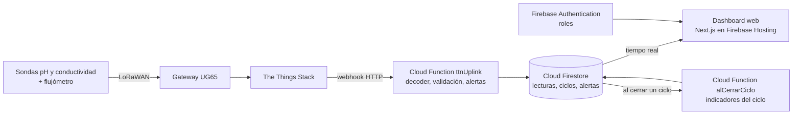

# StormCIP

**Monitoreo IoT en tiempo real de la limpieza industrial CIP (Clean-in-Place).**

Proyecto APT / Capstone · Ingeniería Informática · Duoc UC · Grupo AV_AM_800_Grupo01.

---

## Descripción

**Qué hace.** StormCIP captura las variables de un ciclo de limpieza CIP (pH, conductividad, temperatura y caudal) con sensores LoRaWAN, las guarda en la nube y las muestra en un dashboard web con historial, alertas por umbral e indicadores de cada ciclo.

**A quién va dirigido.** A plantas de alimentos que limpian sus líneas con CIP, como las plantas lácteas (por ejemplo, Soprole o Colun), y en particular a sus operadores y jefes de producción.

**Qué problema resuelve.** Hoy los sensores de la planta se ven solo en el PLC y no dejan historial. No hay datos centralizados, las decisiones son reactivas y no se sabe cuánta agua y químico consume cada ciclo. StormCIP transforma esas mediciones en información para controlar y optimizar el proceso.

**Estado actual (octubre 2026).** El backend y el dashboard están desplegados en Firebase y funcionan con datos simulados. La maqueta física está en armado y faltan instalar las sondas. El análisis predictivo está planificado y aún no se implementa.

---

## Tecnologías utilizadas

| Capa | Tecnología |
|---|---|
| Sensores | Dragino WQS-LB (nodo LoRaWAN) con sondas DR-PH01 (pH) y DR-ECK1.0 (conductividad); flujómetro Dragino SW3L-LB-006 |
| Red | LoRaWAN AU915, gateway Milesight UG65, The Things Stack (webhook) |
| Backend | Firebase Cloud Functions (Node.js 22, TypeScript), `firebase-functions` 6 y `firebase-admin` 12 |
| Base de datos | Cloud Firestore (base de datos documental) |
| Autenticación | Firebase Authentication con roles por *custom claims* (`admin`, `operador`, `visor`) |
| Frontend | Next.js 16, React 19, TypeScript, Tailwind CSS 4, Recharts |
| Cloud | Google Cloud Platform: Firebase Hosting, Secret Manager; región `southamerica-west1` (Santiago) |
| Pruebas | Vitest, `@firebase/rules-unit-testing`, emuladores de Firebase |

---

## Arquitectura de la solución



| Componente | Responsabilidad |
|---|---|
| `ttnUplink` | Recibe el webhook de The Things Stack, decodifica el payload del WQS-LB, valida rangos físicos y genera alertas |
| `ingestLectura` | Endpoint HTTP (`/api/ingest`) para gateways o simuladores que envían lecturas ya decodificadas |
| `alCerrarCiclo` y `recalcularIndicadores` | Calculan los indicadores del ciclo: tiempo hasta agua limpia, arrastre químico, pendiente de conductividad y volumen estimado |
| `onUserCreated` y `setUserRole` | Asignan el rol por defecto (`visor`) y permiten a un admin cambiar roles |
| Dashboard web | Muestra tarjetas por sonda, barra de etapas del CIP, tendencias, alertas e indicadores |

Más detalle en [`EXPLICACION-SISTEMA-SENSORES.md`](AV_AM_800_Grupo01/Fase%202/Evidencias%20Proyecto/Evidencias%20de%20sistema/EXPLICACION-SISTEMA-SENSORES.md) y en el [modelo de datos](AV_AM_800_Grupo01/Fase%202/Evidencias%20Proyecto/Evidencias%20de%20sistema/Base%20de%20datos/modelo-datos-sensores.md).

---

## Ejecutar el proyecto localmente

El sistema se prueba con los **emuladores de Firebase**: una copia local de Firebase que no toca datos reales ni genera costos.

### Requisitos

- Node.js 22 (ver `.nvmrc`)
- Firebase CLI: `npm install -g firebase-tools`
- Java 21 o superior (lo exigen los emuladores de Firestore y Auth)

### Pasos

Todos los comandos se ejecutan dentro de la carpeta de la aplicación. La ruta tiene espacios y tildes, así que va entre comillas:

```bash
cd "AV_AM_800_Grupo01/Fase 2/Evidencias Proyecto/Evidencias de sistema/Aplicación/stormcip"
```

**1. Instalar dependencias**

```bash
cd functions && npm install && cd ../scripts && npm install && cd ../web && npm install && cd ..
```

**2. Configurar los secretos locales** (no se suben a git)

- `functions/.secret.local` con la línea `TTN_WEBHOOK_SECRET=test-secret`
- `web/.env.local` con:

```
NEXT_PUBLIC_USE_EMULATORS=true
NEXT_PUBLIC_FB_PROJECT_ID=stormcip-dev
NEXT_PUBLIC_FB_API_KEY=emulador-local
NEXT_PUBLIC_FB_AUTH_DOMAIN=stormcip-dev.firebaseapp.com
NEXT_PUBLIC_FB_APP_ID=emulador-local
```

**3. Levantar los emuladores** (terminal 1)

```bash
firebase emulators:start --project stormcip-dev
```

La interfaz de los emuladores queda en http://127.0.0.1:4000. Los puertos de cada emulador están en `firebase.json`.

**4. Cargar datos de prueba y simular un ciclo** (terminal 2)

```bash
cd scripts
npm run seed
npm run sim:cip
```

`npm run sim:ttn` ejecuta además 5 casos de prueba contra el webhook (uplink válido, pH fuera de rango, dispositivo desconocido, FPort 5 e idempotencia).

**5. Levantar la web** (terminal 3)

```bash
cd web
npm run dev
```

Abrir http://localhost:3000/login. El usuario administrador de prueba lo crea `scripts/seed.js`.

### Pruebas automatizadas

```bash
cd functions && npm test          # pruebas unitarias del backend
cd web && npm test                # pruebas unitarias de la web
cd functions && npm run test:reglas   # reglas de Firestore (requiere el emulador encendido)
```

Más detalle en [`README.md` de la aplicación](AV_AM_800_Grupo01/Fase%202/Evidencias%20Proyecto/Evidencias%20de%20sistema/Aplicaci%C3%B3n/stormcip/README.md). El despliegue a producción se describe en [`DESPLIEGUE.md`](AV_AM_800_Grupo01/Fase%202/Evidencias%20Proyecto/Evidencias%20de%20sistema/Aplicaci%C3%B3n/stormcip/DESPLIEGUE.md); ningún script toca producción sin flags explícitos.

---

## Integrantes del equipo

| Integrante | Rol |
|---|---|
| Cristian Quilaleo | Backend, base de datos, API y almacenamiento |
| Humberto León | Frontend, UI/UX, dashboard y visualización |
| Tamara Quilaleo | Integración, tiempo real y alertas |
| Felipe Carreño | QA, pruebas, documentación y Scrum Master |
| Técnico de hardware | Armado de la maqueta y montaje de sensores |

---

## Metodología de trabajo

Trabajamos con **Scrum**: 7 sprints de 2 semanas más una semana de cierre, entre el 24-08-2026 y la demo al cliente del **04-12-2026**.

| Sprint | Fechas | Foco |
|---|---|---|
| 1 | 24 ago – 6 sep | Arquitectura y cotización de sensores |
| 2 | 7 – 20 sep | Autenticación y compra de sensores |
| 3 | 21 sep – 4 oct | Ingesta de datos y armado de la maqueta |
| 4 | 5 – 18 oct | Primer flujo de punta a punta |
| 5 | 19 oct – 1 nov | Visualización completa e históricos |
| 6 | 2 – 15 nov | Roles, seguridad y robustez |
| 7 | 16 – 29 nov | Pruebas integrales y UAT |
| Cierre | 30 nov – 4 dic | Ajustes finales y presentación del MVP |

El backlog, los hitos y los riesgos se gestionan en la planilla del plan del proyecto. Cada sprint cierra con su documento (`SPRINT1.md`, `SPRINT3.md`) con lo entregado y su *Definition of Done*.

---

## Estructura del repositorio

```
AV_AM_800_Grupo01/
├── Fase 1/                        Evidencias de la Fase 1 (definición del proyecto)
└── Fase 2/
    └── Evidencias Proyecto/
        └── Evidencias de sistema/
            ├── Aplicación/stormcip/       La aplicación
            │   ├── functions/             Cloud Functions (TypeScript)
            │   ├── web/                   Dashboard (Next.js)
            │   ├── scripts/               Seed y simuladores
            │   └── firestore.rules        Reglas de seguridad por rol
            ├── Base de datos/             Modelo de datos y pendientes técnicos
            ├── Gestion Sensores/          Cotización y orden de compra
            └── Informacion Tecnica Sensores/   Datasheet y firmware del WQS-LB
```
